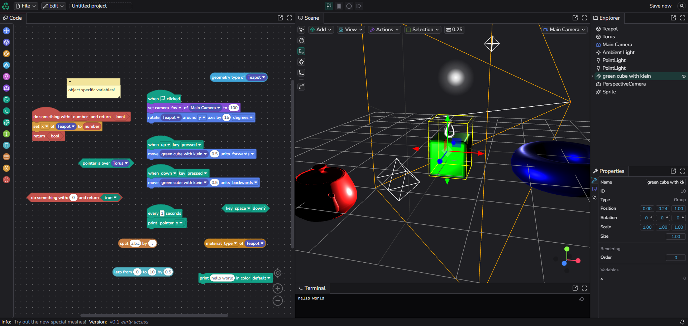

  :construction: Heavy work in progress! This post is very detailed, and one of
  the most important ones. Because *I can't wait*, I've already uploaded some
  progress. Sit back, grab yourself a snack and enjoy! (Here are some seats:
  :seat: :seat:)

Graplet is a 3D Editor that runs in the browser. You build a 3D scene by hand
and then you make it do things with code blocks, similar to those of [Scratch](https://scratch.mit.edu/editor#)

---

_A bit of history..._ The name "Graplet" was maybe coined back 4 or 5 years,
although not always been used for this project. It moved between several
rewrites, starting as a poorly designed flask, to a somewhat generic emulator using
[Blockly](https://www.blockly.com/#) (library for visual programming)

---

There exists a current prototype, but the structure is bananas, so I'm gathering a
few friends to code it from the ground up, with a clean structure :monkey_face:

If you insist on seeing it, it's live [Here](https://graplet.vercel.app/editor#)  
_(this link will take you straight to the editor)_

<figure>

<figcaption>
The Editor. Blocks are on the left, the 3D scene in the middle, Explorer and Properties on the right,
and the Terminal is under the scene
</figcaption>
</figure>

In the first part I'll explain how to use Graplet, panels, navigation, shortcuts and
etc, on the second part about its core philosophy and so on. If you're not planning
on visting the prototype, feel free to skip this part.

# Site Navigation

In Graplet, you can create instructions & programs. Those will ultimately drive
what's happening on the Scene. The Scene can be found on the right,  
it's a Panel: `🖥️ Scene`, Just like `🧩 Code` or `>_ Terminal`.

Using code blocks from the Toolbox in the `🧩 Code`, starting off with an event  
`When 🏴 clicked` "hat" block (those are the blocks with the bumps, which fire off
Events), you can brick together tiny scripts which will form your entire program.
You may conditionally move objects, create and delete them, call functions, set
variables and so on...

In the `🖥️ Scene`, which has a 3D Editor similar to [Blender](https://www.blender.org/about/#), heavily simplified,
you can create 3D models, edit their scale, rotation, position and edit their points,
extrude their faces, use the Keybinds you'd expect on Blender too. [^1]

[^1]:
    This is a work in progress, making it more familiar to existing Blender users is
    still a goal to achieve, current 3D Editor has a lot of things to improve on.  
    (if you're a 3D modeller yourself, don't hesitate to tell me what's missing, I'll
    always appreciate feedback :smile:)

## Customization

The Tab Panels are all moveable around freely, docking them wherever you want.
Pop them out, make them Fullscreen, that's up to you. [^2]

[^2]:
    Although Panels are very customizable, there has been some feedback that
    implied an improvement on the docking panels to this part: it's not really
    possible to "move away" one dock but leave the rest as is, like a side dock.
    That feature does exist within [Dockview](https://dockview.dev/#), our Panel manager, so It's a part of
    the rewrite.

### Keybinds

Did somebody say Keybinds? Hell yeah!

There's a `⌨ Keybinds` Panel, too. It's not perfect, but you can search Keybinds and
modify them with a new key of your choice. To open it, either go to the menu: _`File > ⌨ Keybinds`_, or use the shortcut to open it: <kbd>CTRL</kbd> + <kbd>Shift</kbd> + <kbd>/</kbd>  
(numpad shift doesn't work, you need shift) [^3]

[^3]:
    Numpad shift might be a good idea, I'm not sure. The Keybind is actually just
    supposed to be <kbd>CTRL</kbd> + <kbd>/</kbd>, the <kbd>Shift</kbd> key is only because it's needed for
    pressing <kbd>/</kbd> _(duh)_

For the Scene, typical Blender Keybinds are defaults. Some of the Keybinds are managed by Blockly, as they have their own internal Binding system, so Graplet externally modifies them, instead of using our own Keybind manager.

# Goal and Mindset

The whole philosophy behind Graplet is that you can create anything that you
can imagine, using just a few code blocks and some 3D Objects. You don't need a
heavy game engine to create beautiful online games, animations, music [^4].  
Really, a n y t h i n g you can think of. The only thing limiting you  
is your own imagination.

It intends to be a generic useful tool too, say you're a modeller and you just want
to quickly scaffold a few things, and share your models on Graplet.

Or, you want to visualize a 3D mathematical graph; you can do so with points rendered in the 3D canvas 😎. Whether you're a mathematician, engineer or artist; everything that can be built from your imagination can be built on Graplet.

And what are great projects without sharing too? The goal is to build a platform,
to socialize with people, collaborate on projects together, in a Team 🚂

[^4]: That is a planned feature too, sounds from code blocks (a dedicated `🔈 Sound`
Toolbox category) and matching Plugins to create music directly in Graplet,
virtual pianos, drums, synths and other instruments. It isn't part of core
Graplet, but a very big art supply, which shouldn't be missing!

---

🚧 _TO BE CONTINUED_

[Graplet Architecture, (subfolder)](/blog/graplet/architecture)

---

# Stack

This part describes the bit more technical part of Graplet, mainly just libraries
used to make stuff. If you want to contribute, or find it interesting what Graplet is
made of, read along -

Here is a curated list of software that is being used for Graplet:

[React](#https://react.dev#)
_The library for web and native user interfaces_

[Blockly](#https://blockly.com/#)
_Library for visual programming_

[Dockview](#https://dockview.dev#)
_The docking layout manager_

[Zustand](#https://zustand.docs.pmnd.rs/#)
_State management solution_

---

# Join us

Think you'd be a great fit for beta testing?

Reach me here: [heliacer@gmx.ch](mailto:heliacer@gmx.ch), or on Discord, my username is `heliacer`

Can't wait to see you!

[🎊 Invite to our Community](https://discord.gg/JBM2NVMECD#)
