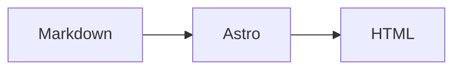

🚧 _Work in progress_

<div class='note'>
**Note**: This post serves as a markdown spec for testing. If you want a custom website, contact me per mail (heliacer@gmx.ch) 
</div>

Normal text

Paragraph. Lorem ipsum dolor sit amet text and no continuation because i don't want to waste my time going to the "lorem ipsum" website copying the actual text, but waste my time here writing this stupid text instead.

[heliacer website link](https://heliacer.ch)


Horizontal rule below

---


# Header 1

Some text

## Header 2

Some text

### Header 3

Some text

#### Header 4

Some text

##### Header 5

Some text

###### Header 6

Some text

Setext Header 1
===============

Some text

Setext Header 2
---------------

Some text

**Bold** text, _italic_ text, _italic with underline_, ~~strikethrough~~

***bold and italic***, **bold with _nested italic_ inside**, ~single tilde strike~

> blockquote

> multi-line blockquote
> second line
>
> > nested blockquote
>
> - list inside a quote
> - **bold** inside a quote

`inline code`

`` code with a ` backtick inside ``

1. numbered
2. list

- normal
- list

```ts
const tsCode = 'what up'
// comment
function foo() {
  type Date = { goo: 'gaa' }
}
```

## Spec: leaf blocks

### Thematic breaks

---

***

___

### Indented code block

    this is indented code
    four spaces, no language, no highlighting

### Fenced code (variants)

~~~
tilde fence, no language
~~~

```js {1,3} title="meta string"
const a = 1
const b = 2
const c = 3
```

````md
nested fence:
```ts
const x = 1
```
````

### HTML blocks

<div align="center">
  <strong>raw html block</strong>
</div>

<details>
<summary>Click to expand</summary>

Hidden **markdown** content inside details.

</details>

### Link reference definitions

[reference link][heliacer] and [another one][gh] and [implicit link][].

[heliacer]: https://heliacer.ch "Heliacer"
[gh]: https://github.com/Heliacer
[implicit link]: https://astro.build

![reference image][rose]

[rose]: https://docs.astro.build/assets/rose.webp "Rose"

### Tables

| Left | Center | Right |
| :--- | :----: | ----: |
| a    |   b    |     c |
| `code` | **bold** | [link](https://heliacer.ch) |
| pipe \| escaped | ~~strike~~ | _italic_ |

Minimal table:

a | b
- | -
1 | 2

## Spec: container blocks

### Lists

- unordered with dash
* unordered with star
+ unordered with plus

5. ordered starting at five
6. next
7. and next

1. first
   - nested bullet
   - another
     1. deep ordered
     2. deeper
2. second

- loose item

- another loose item, with paragraph spacing

- item with a code block:

  ```bash
  echo "inside a list"
  ```

### Task lists

- [x] done
- [ ] not done
- [ ] nested tasks
  - [x] child done
  - [ ] child open

## Spec: inlines

### Backslash escapes

\*not italic\* \# not a header \[not a link\] \`not code\`

### Entities

&copy; &amp; &lt;tag&gt; &#35; &#x1F680;

### Line breaks

Hard break with two trailing spaces  
second line.

Hard break with backslash\
second line.

Soft break,
just a newline in source.

### Links

[inline link](https://heliacer.ch "with title")

[relative link](/blog/)

[popup link](/#)

### Autolinks

Extended autolinks: www.heliacer.ch and https://astro.build and hello@heliacer.ch

### Images


[](https://astro.build)


### Raw inline HTML

Press <kbd>Ctrl</kbd> + <kbd>C</kbd>, H<sub>2</sub>O, x<sup>2</sup>, <mark>marked</mark>, <ins>inserted</ins>.

### Footnotes

Here is a sentence with a footnote.[^1] And another one.[^note]

[^1]: The first footnote.
[^note]: A named footnote with **markdown** and a [link](https://heliacer.ch).

### Emoji shortcodes

:rocket: :tada: :construction: (unicode: 🚀 🎉 🚧)

### Mermaid



### Diff and other languages

```diff
- removed line
+ added line
```

```json
{ "name": "heliacer", "private": true }
```

```astro
---
const { title } = Astro.props
---
<h1>{title}</h1>
```

### Collapsible with table inside

<details>
<summary>Table in details</summary>

| a | b |
|---|---|
| 1 | 2 |

</details>

### Highlight edge cases

Text with trailing spaces and a [^missing] footnote reference that has no definition.

Line with an emoji at the end 🚧